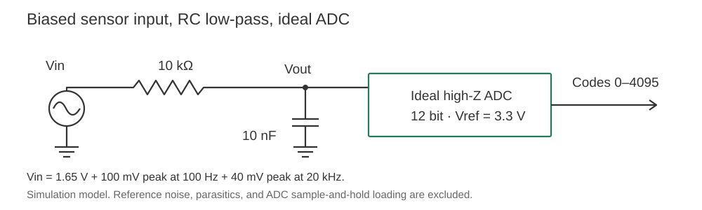
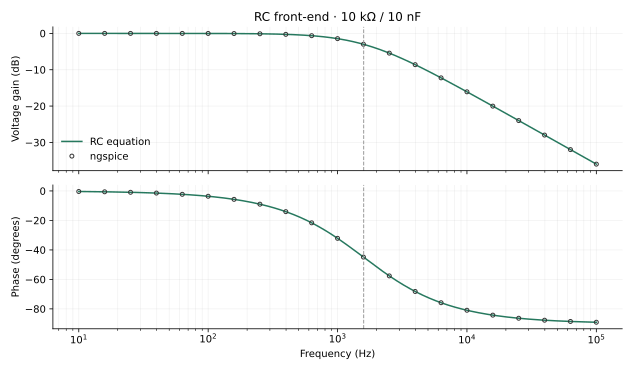
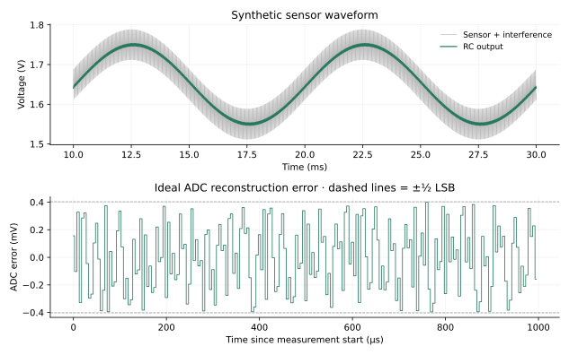
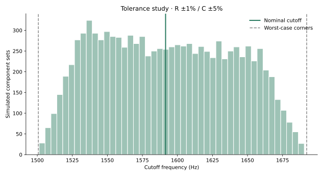

# Analog front-end lab

A simulation of a low-voltage sensor input: a 10 kΩ / 10 nF RC filter, 1.65 V bias, and an ideal 12-bit ADC with a 3.3 V reference. The goal is to preserve a 100 Hz signal while reducing a separate 20 kHz interference tone, then examine component tolerance and quantization.



This is a completed simulation study, not a fabricated circuit or a hardware measurement. Python provides the equations, waveforms, tolerance study, and ADC model. ngspice independently checks the RC response.

## Run

Use Python 3.10 or newer. From the repository root:

```sh
python3 -m venv .venv
source .venv/bin/activate
python -m pip install -r requirements.txt
python -m unittest discover -s tests -v
python src/front_end.py --out results/python
```

Windows activation: `.venv\Scripts\activate`. Only NumPy and Matplotlib are required for the Python analysis.

To regenerate the committed results, also install [ngspice](https://ngspice.sourceforge.io/download.html) and make it available on PATH:

```sh
python src/front_end.py --out results --spice
```

Use `--ngspice /path/to/ngspice` if necessary. This runs AC and transient checks and returns an error if they exceed the declared tolerances. `make test`, `make run`, and `make spice` provide the same entry points.

## Nominal results

The synthetic input is 1.65 V plus a 100 mV-peak, 100 Hz sine and a 40 mV-peak, 20 kHz sine. The ADC samples at 200 ksample/s. The run lasts 30 ms; the first 10 ms are excluded from waveform error and ratio calculations.

| Quantity | Result |
| --- | ---: |
| RC cutoff | 1,591.549 Hz |
| Gain at 100 Hz | 0.998032 V/V |
| Gain at 20 kHz | 0.079327 V/V |
| Input signal/interference ratio | 7.959 dB |
| Filtered signal/interference ratio | 29.953 dB |
| Signal/total error after ideal ADC | 29.906 dB |
| ADC LSB | 805.664 µV |
| ADC reconstruction error RMS | 230.615 µV |
| Analog output range | 1.5470–1.7530 V |
| ADC clipping | 0 of 6,000 samples |

The ratio improvement is about 22 dB for these two tones. It is not broadband SNR, ENOB, or proof that the circuit is a sufficient anti-alias filter for a real ADC.



The open markers are ngspice AC results; the green curve is the RC equation. For the recorded ngspice 42 run, all 401 frequency points pass a relative complex-error tolerance of 1e-6. The actual maximum is approximately 9.81e-16. The transient check differs from the analytical output by at most 1.267 µV after the measurement start, below the 10 µV threshold. This agreement checks the ideal circuit model, not real component accuracy.



## Equations and ADC convention

The unloaded filter uses `H(jω) = 1 / (1 + jωRC)` and `fc = 1 / (2πRC)`. The time-domain response is the exact sine response plus its decaying initial-condition term. The capacitor begins at the 1.65 V DC bias. There is no Euler time-step approximation in the Python waveform model.

The ideal ADC has `2^12 = 4096` bins of width `3.3 / 4096 V`. Each input maps to its lower-bin code, clamped to 0–4095, and is reconstructed at the center of that bin. The nonclipped reconstruction error is bounded by half an LSB. Values below 0 V or at/above 3.3 V are flagged as clipped.

The RC resistor's ideal equilibrium thermal estimate, `sqrt(kT/C)`, is 0.644 µV RMS at 300 K. The usual uniform-error ADC estimate, `LSB/sqrt(12)`, is 232.575 µV RMS. These are analytical estimates; thermal noise is not injected into the plotted waveform, and the deterministic ADC error need not be perfectly uniform.

## Component variation



The study draws 10,000 independent component sets with uniform R ±1% and C ±5% variation, using seed 7. The 5th–95th cutoff percentiles are 1,521.85–1,666.93 Hz. Deterministic worst-case corners are 1,500.75–1,692.24 Hz. These bounds describe the chosen tolerance model, not measured production data or a confidence interval for actual devices.

## Files

- `src/front_end.py`: equations, waveform and ADC models, tolerance study, CLI, and SPICE cross-check.
- `spice/rc_ac.cir`: nominal AC netlist.
- `spice/rc_transient.cir`: nominal biased sensor and interference netlist.
- `tests/test_front_end.py`: 19 tests.
- `results/metrics.json`: exact configuration and recorded numerical results.
- `results/frequency_response.csv`: 401-point AC response.
- `results/waveforms.csv`: all 6,000 simulated ADC samples.
- `results/spice_ac_check.csv`: theory and independent SPICE values at the same frequencies.
- `results/cutoff_distribution.csv`: histogram bins for the tolerance sweep.
- `results/report.md`: generated report.

The large raw ngspice transient output is regenerated in ignored `build/`, rather than committed. To run the nominal netlists directly:

```sh
mkdir -p build
ngspice -b spice/rc_ac.cir
ngspice -b spice/rc_transient.cir
```

The generated netlists in `build/` use the current CLI parameters. The checked-in `spice/` copies use the nominal component values.

## Verification and limits

The tests check DC gain, the -3.0103 dB / -45° cutoff, high-frequency roll-off, finite-load behavior, initial conditions, the RC differential equation via an independent numerical derivative, ADC bins and half-LSB error bounds, tolerance corners, reproducible seeds, and time-domain versus frequency-domain tone ratios.

The main simulation assumes an ideal source, ideal bias, and infinite ADC input impedance. A finite resistive load changes both gain and cutoff; a real ADC's switched sampling capacitor is more complicated still. Reference noise, amplifier behavior, INL/DNL, aperture jitter, parasitics, and physical anti-alias performance are excluded. A hardware extension needs a chosen ADC, acquisition/settling analysis, real bias circuitry, and measured waveforms before making board-level claims.

## Related machine-learning project

[Sensor Signal Classifier](projects/sensor-signal-classifier/) is a separate personal project in this repository. It compares fixed rules, logistic regression, and a random forest on simulated ADC signal conditions, with device-disjoint splits and a noise stress test. Its code, setup instructions, and results are self-contained in that folder.

## References

- [Texas Instruments: low-pass filtered non-inverting amplifier](https://www.ti.com/tool/CIRCUIT060057): background on an RC input pole. This lab models the passive RC portion only, not TI's amplifier circuit.
- [ngspice documentation](https://ngspice.sourceforge.io/docs.html): AC and transient simulation and control commands.

[Matthew Li's engineering portfolio](https://matthew-li-portfolio.li-matthew01.chatgpt.site)
