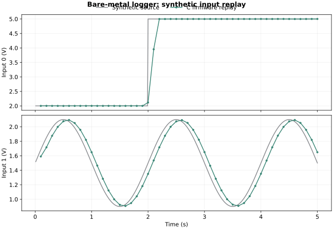

# Bare-metal STM32 sensor logger

A register-level C firmware project for **NUCLEO-F401RE**, paired with the [dual-channel sensor interface PCB](../sensor-interface-pcb/). TIM2 starts a two-channel ADC scan at a nominal 100 Hz. DMA moves the results into a circular buffer; the application maintains a 16-sample average and sends binary records over USART2. There is no HAL or RTOS.

**The firmware cross-builds for Cortex-M4 and its portable application has been tested on a Linux host. It has not been flashed or validated on a physical Nucleo.** Register setup, interrupt behavior, USB serial and analog accuracy still need bench testing.



## Implementation

- HSI 16 MHz clock, with no external oscillator or PLL dependency. Sampling and baud rates are nominal and inherit HSI tolerance.
- PA0 / PA1 as ADC1 channels 0 / 1; 12-bit scan, 144 sample cycles at an 8 MHz ADC clock.
- TIM2 TRGO update at 100 Hz: prescaler 1599, auto-reload 99. A nominal two-channel conversion takes 39 µs.
- DMA2 stream 0, channel 0; circular four-halfword buffer. Half-transfer and transfer-complete interrupts each publish a complete pair to a bounded SPSC queue.
- USART2 on PA2 / PA3, 115200 8N1, using the Nucleo's ST-LINK virtual COM connection. RX and TX each use a 256-byte ISR/main queue. A frame is enqueued completely or dropped completely.
- SysTick at 1 ms for report scheduling, a partial-command timeout and stale-data detection. The main loop sleeps with `WFI` between interrupts.
- Startup/vector table, linker script, `.data` copying and `.bss` clearing are included. No heap, floating point or libc is required.

The main loop owns application state. ISR fault notifications use lock-free 32-bit atomics. The queues are designed for one ISR producer and one main consumer, or the reverse, on a single Cortex-M4; they are not a general multi-thread queue.

DMA errors, ADC overruns and simultaneous half/full DMA flags stop acquisition and latch a fault. A full sample queue drops the newest pair. UART errors, RX overflow and TX overflow are counted and latched. Missing samples for more than 50 ms set a stale flag. Faults clear on reset; serial commands cannot silently restart failed acquisition.

## Build and tests

Install GNU Arm Embedded GCC 13 or newer and GNU Make:

```sh
make all
make test
python3 -m venv .venv
. .venv/bin/activate
python -m pip install -r requirements.txt
make replay
```

`make test` needs a native GCC with AddressSanitizer and UndefinedBehaviorSanitizer plus Python 3.10+. In containers where LeakSanitizer cannot inspect `/proc`, run `ASAN_OPTIONS=detect_leaks=0 make test`; address and undefined-behavior checking stay enabled. The application does not allocate heap memory.

Recorded verification:

| Check | Result |
| --- | --- |
| Native C scenarios | 10 passed with ASan/UBSan |
| Python protocol tests | 6 passed |
| Single-bit frame corruption | Every one of 176 bit positions rejected by each decoder |
| C/Python wire compatibility | Identical encoded golden frame |
| Synthetic ADC replay | 500 input pairs → 50 decoded telemetry frames; averages and CRCs match |
| ARM build | Cortex-M4 ELF, BIN and Intel HEX generated; no unresolved symbols |

The C tests exercise queue capacity and counter wrap, parser corruption/resynchronization, partial-frame timeout across tick rollover, average warm-up/sliding, stale readings, command boundaries and saturated error counts. These tests exercise software behavior; they do not emulate ADC, DMA or USART hardware.

The replay drives the **same `src/logger.c` used by the target firmware** with synthetic ADC codes from a divider / ideal-buffer / RC model. It includes a voltage step, a slow sine and small seeded code noise. Its CSV, HEX and SVG outputs are in `results/`. Neither the plot nor the test results are hardware measurements.

## Hardware wiring and programming

Connect the companion PCB J1.1 to Nucleo CN6.4 (3.3 V), J1.2 to CN6.6 (GND), J1.3 to CN8.1 (A0/PA0), and J1.4 to CN8.2 (A1/PA1). The interface halves its 0–6 V inputs before buffering them. Do not connect a 6 V signal directly to a Nucleo ADC pin.

Use a data-capable cable on the ST-LINK USB connector. The default F401RE board's virtual COM route connects USART2 to ST-LINK; verify its solder-bridge configuration in UM1724 if the board has been modified.

The included `release/logger.hex` is an **unflashed prototype build**, not a known-good hardware release. With the correct board connected, use STM32CubeProgrammer or OpenOCD. Example OpenOCD command:

```sh
openocd -f interface/stlink.cfg -f target/stm32f4x.cfg \
  -c "program release/logger.hex verify reset exit"
```

Read the bring-up steps in the PCB project first. Start with known low DC input voltages; compare both ADC readings against a DMM and scope the sample timing before relying on measurements.

## Capture or replay

```sh
# No hardware needed:
python host/logger.py --replay results/telemetry.hex --out build/replay.csv
# With the programmed board connected; choose the actual COM port:
python host/logger.py --port /dev/ttyACM0 --seconds 10 --out build/capture.csv
# Example measured reference and faster reporting:
python host/logger.py --port /dev/ttyACM0 --vref-mv 3295 --period-ms 50
```

`--vref-mv` accepts 3000–3600 mV; enter the measured ADC reference. It does not calibrate the divider, op-amp or ADC. Input conversion is `average_code × vref_mV × 2 / (4095 × 1000)` volts, using an endpoint scaling convention. Full-scale ADC code is 6.6 V equivalent at a 3.3 V reference, but the PCB's specified operating input range ends at **6.0 V**. Do not infer an extended input rating from that mathematical limit.

The first reports average the samples available so far. Thereafter, the window is 16 samples (160 ms at 100 Hz). Reporting defaults to 10 Hz; it can be changed to 20–2000 ms. A delayed main loop skips missed reports rather than producing a catch-up burst. Use the sequence and fault fields to identify dropped output or stale data.

## Protocol

Every frame is 22 bytes, little-endian. CRC-16/CCITT-FALSE uses polynomial `0x1021`, initial value `0xffff`, no reflection and no final XOR. The check value for `123456789` is `0x29b1`.

| Offset | Size | Field |
| --- | --- | --- |
| 0 | 2 | `a5 5a` sync |
| 2 | 1 | Version 1 |
| 3 | 1 | Type |
| 4 | 2 | Sequence, wraps at 65536 |
| 6 | 4 | Latest sample tick in ms; ACK uses current tick |
| 10 / 12 | 2 each | Averaged ADC0 / ADC1; command argument / reserved |
| 14 | 2 | ADC reference in mV |
| 16 | 2 | Saturating dropped/error-event count |
| 18 | 2 | Latched fault flags |
| 20 | 2 | CRC over bytes 0–19 |

Type `0x01` is telemetry. Commands are `0x10` (report period), `0x11` (reference voltage) and `0x12` (status). Commands place their argument at offset 10; tick and all remaining payload fields must be zero. ACK type `0x80` echoes the command sequence, returns status at offset 10 (`0` accepted, `1` invalid argument, `2` unknown type), and the command type at offset 12. Valid commands change runtime settings only; settings return to defaults on reset. The Python capture prints ACKs to stderr.

Flags: `1` invalid ADC code, `2` sample queue overflow, `4` DMA error, `8` ADC overrun, `16` RX overflow, `32` TX overflow, `64` DMA serviced too late, `128` UART hardware error, `256` stale samples. Flag `512` marks a telemetry record with no samples yet. The error-event counter combines these events; it is not an exact count of lost conversions. One sequence increments for every attempted telemetry publication.

## Files and sources

- `src/logger.c`, `include/logger.h`: portable filtering, scheduler, queues and protocol.
- `src/stm32f401.c`: target register/interrupt implementation.
- `src/startup.S`, `stm32f401re.ld`, `src/runtime.c`: startup and freestanding runtime.
- `tests/`, `host/`, `scripts/`: host verification, serial capture and replay.
- `release/build.json`: recorded toolchain, sizes and binary hash.
- [ST RM0368](https://www.st.com/resource/en/reference_manual/rm0368-stm32f401xbc-and-stm32f401xde-advanced-armbased-32bit-mcus-stmicroelectronics.pdf): register definitions, ADC trigger table, DMA mapping and interrupt numbers.
- [ST UM1724](https://www.st.com/resource/en/user_manual/um1724-stm32-nucleo64-boards-mb1136-stmicroelectronics.pdf): board pinout and virtual COM routing.
- [STM32F401RE datasheet](https://www.st.com/resource/en/datasheet/stm32f401re.pdf): memory sizes, clock and analog limits.
- [OpenOCD flash programming](https://openocd.org/doc/html/Flash-Programming.html): programming workflow.
