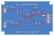
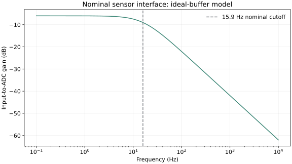

# Dual-channel sensor interface PCB

A 60 × 40 mm, two-layer board for connecting two slow, positive voltage signals to a NUCLEO-F401RE. Each channel has a 2:1 resistor divider, an MCP6002 voltage follower, and a 10 kΩ / 1 µF output filter. The MCU stays on the Nucleo board; a four-wire harness carries power, ground and the two ADC inputs.

**Revision A is a CAD prototype.** It has not been fabricated, assembled or measured. KiCad checks and an ideal-buffer simulation are complete; they do not establish hardware performance or production readiness.



## Circuit choices

The intended input range is 0–6 V with the interface powered from regulated 3.3 V. Two 33 kΩ, 1% resistors load each input by 66 kΩ and produce half the input voltage. At 6 V, the nominal buffer input is 3.0 V. The MCP6002 runs from 3.3 V; both amplifiers are unity-gain followers. The 10 kΩ resistor isolates the amplifier from the 1 µF ADC-side capacitor. C1 is the local 100 nF bypass, and C4 adds 4.7 µF near the harness.

The nominal RC cutoff is `1 / (2π × 10000 × 1e-6) = 15.915 Hz`. This design is intended for signals below roughly 5 Hz. A single RC pole is not a guarantee of alias rejection for arbitrary interference at the 100 Hz acquisition rate.

The 1% divider corners are 0.495–0.505 V/V. Assuming R ±1% and effective C ±10%, the cutoff corners are 14.325–17.863 Hz. Actual ceramic capacitance can change with DC bias and temperature; select a part whose effective capacitance meets the design target. These calculations exclude op-amp offset/noise, ADC reference error, switched-capacitor loading and layout parasitics.

## Connection to the Nucleo

J1 is a **wired harness**, not an Arduino shield footprint. Read the pin-1 square pad and silkscreen before connecting it.

| PCB pin | Signal | NUCLEO-F401RE connection |
| --- | --- | --- |
| J1.1 | +3V3 | CN6.4, 3.3 V output |
| J1.2 | GND | CN6.6, ground |
| J1.3 | ADC0 | CN8.1, A0 / PA0 / ADC1 channel 0 |
| J1.4 | ADC1 | CN8.2, A1 / PA1 / ADC1 channel 1 |
| J2.1 / J2.2 | Input 0 / ground | External 0–6 V signal / common ground |
| J3.1 / J3.2 | Input 1 / ground | External 0–6 V signal / common ground |

Supply this board from **3.3 V**, and disconnect external signals when its power is off. There is no reverse-polarity protection, isolation or overvoltage clamp; the divider is a scaling network, not a protected industrial input.

The matching [bare-metal STM32 logger](../bare-metal-stm32-logger/) configures these ADC channels and sends CRC-protected records through the Nucleo's ST-LINK virtual COM port.

## CAD and checks

Open `sensor-interface.kicad_pro` in **KiCad 7 or newer**. The schematic embeds its symbols. The PCB embeds its footprint geometry and also references the standard KiCad footprint libraries through `fp-lib-table`. On KiCad versions with a different library environment name, set `KICAD7_FOOTPRINT_DIR` to your installed footprint directory or update that table.

Recorded KiCad 7.0.11 results:

| Check | Result |
| --- | --- |
| Physical/electrical DRC | 0 violations |
| Unconnected pads | 0 |
| Footprint errors | 0 |
| Schematic-to-board net membership | All 36 pin connections across 10 nets match |
| Layout | 0.25 mm tracks; eight 0.6 / 0.3 mm vias; four 3.2 mm mounting holes |

`results/drc.txt` is the native KiCad report. `results/verification.json` records the independent netlist comparison. **ERC was not run**: the installed KiCad 7 CLI has no ERC command. Run ERC in the schematic editor and review the schematic and footprints before ordering. Zero DRC errors do not prove the circuit works.

On a Linux KiCad installation whose Python can import `pcbnew`:

```sh
make check
make export
# Optional regeneration from design.json; this replaces manual layout edits:
make regenerate
make check
make export
```

`design.json` is the generator's component/pin manifest. `scripts/build_board.py` places standard footprints, routes both layers and fills the back ground plane. The editable `.kicad_pcb` is the board used for the recorded DRC and exports. After manual CAD edits, use `make check` and `make export`, not `make regenerate`.

## Analog model

```sh
python3 -m venv .venv
. .venv/bin/activate
python -m pip install -r requirements.txt
python scripts/analyze.py --ngspice ngspice
```

The 401-point ngspice AC check uses an **ideal voltage-controlled buffer**, not an MCP6002 device model. It agrees with the analytical divider-plus-RC response to a maximum complex error of about `1.3e-9 V/V`. See `results/analog.json`, `results/frequency.csv` and the generated plot. This validates the passive calculation only.



## Fabrication package and bring-up

`fabrication/` contains the copper, solder mask, paste, silkscreen, board outline and metric Excellon drill export. The drill file declares plated vias, plated header holes and nonplated mounting holes separately in its tool attributes. `bom.csv` lists values, ratings and footprints; select exact passive parts and check their dimensions and capacitor derating before assembly. The U1 package is SOIC-8, **MCP6002-I/SN**.

The first physical checks are still pending:

1. Run schematic ERC and review the generated fabrication layers, drill plating and component orientation.
2. Inspect for shorts, then power from a current-limited 3.3 V source with signal sources disconnected. Check U1 pins 8 and 4.
3. Apply known, common-ground DC voltages to one input at a time. Measure the divider, buffer and ADC nodes before connecting the MCU.
4. Flash the companion firmware, enter the measured ADC reference voltage, and compare stable readings against a DMM.
5. Scope a slow input step and the ADC node. Check settling, reference noise and stability with the actual selected capacitors and wiring.

## Sources

- [Microchip MCP6001/2/4 datasheet, DS20001733L](https://ww1.microchip.com/downloads/en/DeviceDoc/MCP6001-1R-1U-2-4-1-MHz-Low-Power-Op-Amp-DS20001733L.pdf): package pins, supply range and amplifier characteristics.
- [ST Nucleo-64 manual, UM1724](https://www.st.com/resource/en/user_manual/um1724-stm32-nucleo64-boards-mb1136-stmicroelectronics.pdf): F401RE connector mappings.
- [ST STM32F401RE datasheet](https://www.st.com/resource/en/datasheet/stm32f401re.pdf): ADC and device electrical characteristics.
- [KiCad library license](https://www.kicad.org/libraries/license/): standard footprint attribution and exception.
