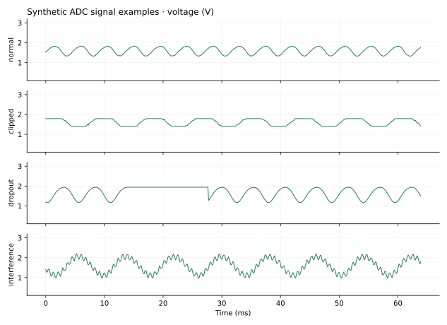
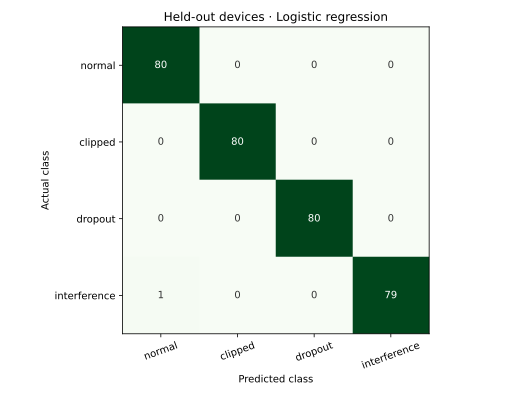
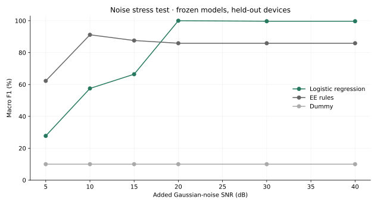

# Sensor Signal Classifier

A personal machine-learning project connecting signal processing with supervised classification. Given a short ADC record, distinguish four simulated conditions: normal, hard-limited, stale-sample dropout, and high-frequency interference.

The useful question is how the learned model compares with simple engineering rules, especially when the noise changes. All data is generated by this project; these are not recordings or diagnoses from real sensors.

## Run

Use Python 3.11 or newer. From this project folder:

```sh
python3 -m venv .venv
source .venv/bin/activate
python -m pip install -r requirements.txt
python -m unittest discover -s tests -v
python sensor_ml.py train --out results
python sensor_ml.py predict --input examples/normal.csv
```

From the parent repository, first run `cd projects/sensor-signal-classifier`. On Windows, activate with `.venv\Scripts\activate`.

Training writes a fitted model to ignored `build/model.joblib`. Inference loads that generated model and expects one `voltage_v` CSV column containing 512 samples captured at 8 ksample/s. The downloadable portfolio bundle also includes the trained snapshot. Use the pinned dependencies for the recorded experiment; versions are in `results/metrics.json`.

## Dataset

- 40 simulated devices, 10 windows per class per device: 1,600 records.
- Each record has 512 samples at 8 ksample/s, quantized into 12-bit bins over 3.3 V.
- Device-specific gain and bias; independent per-window amplitude, phase, frequency, and noise.
- Nominal Gaussian-noise SNR is uniform from 20 to 40 dB, referenced to the clean signal RMS.
- Base tones vary from 80 to 400 Hz, with a small second harmonic.
- Clipping is hard limiting around the device bias, potentially below the ADC rails.
- Dropout holds one previous ADC code for a contiguous 42–128 samples.
- Interference adds a separate 1.1–2.7 kHz tone at 15–75% of the fundamental amplitude.



These are four isolated synthetic conditions. Mixed faults, other sensor dynamics, acquisition hardware, and unknown classes are outside the experiment. The clipping class is not a claim that an actual ADC exceeded its supply rails.

## Features and evaluation

Fifteen per-record features cover AC RMS, peak-to-peak level, crest factor, kurtosis, zero crossings, flat segments, rail fraction, dominant frequency, spectral centroid, high-band energy, normalized spectral entropy, first differences, and interquartile range. Features use only the waveform; class labels and device IDs are excluded.

The split is **24 training / 8 validation / 8 test devices**, corresponding to 960 / 320 / 320 records. A device never crosses split boundaries. This avoids evaluating on another window from a training device. All splits still share the same synthetic generation rules.

The logistic-regression scaler is fitted only on training records through a scikit-learn pipeline. Hyperparameters are fixed: logistic regression C=1; random forest 200 trees, maximum depth 8, minimum leaf size 3. Models are selected by validation macro F1, with ties favoring logistic regression. Test data and noise-shift results do not choose the model, and there is no refit on validation or test records.

## Recorded results, seed 7

| Model | Validation macro F1 | Test accuracy | Test macro F1 |
| --- | ---: | ---: | ---: |
| Most-frequent dummy | 10.00% | 25.00% | 10.00% |
| Fixed EE rules | 89.19% | 86.25% | 85.87% |
| Logistic regression | 100.00% | 99.69% | 99.69% |
| Random forest | 100.00% | 100.00% | 100.00% |

**Selected: logistic regression.** Both learned models tie on validation. The simpler model wins the predefined tie-break; the forest's higher test result does not change that decision.



The high scores apply to clearly defined synthetic conditions and one fixed device split. They do not estimate real-world fault-detection accuracy.

## Noise stress test



The selected model is kept frozen and evaluated on the same held-out device IDs at fixed noise levels. Records are paired across conditions, so these curves are dependent stress tests rather than new independent test subjects.

At 5 dB, logistic regression reaches only **36.56% accuracy / 27.74% macro F1**. The fixed rules do better: **70.63% accuracy / 62.26% macro F1**. The project retains this failure instead of selecting a new model from the stress-test outcomes. Noisy training examples and recordings from real sensors would be needed for a more practical model.

The EE baseline uses fixed thresholds: a long flat segment indicates dropout, shorter repeated-value plateaus indicate clipping, and high-band energy indicates interference. These thresholds were set before training.

## Files and verification

- `sensor_ml.py`: generator, features, baselines, model training, evaluation, figures, and inference CLI.
- `tests/test_sensor_ml.py`: 16 tests covering seeds, group isolation, balanced classes, ADC bins, feature behavior, training-only scaling, and model output.
- `results/features.csv`: all features, device IDs, split assignments, and labels.
- `results/test_predictions.csv`: held-out predictions for all four approaches.
- `results/model_comparison.csv`, `noise_sweep.csv`, and `confusion.csv`: numerical results behind the figures.
- `results/metrics.json`: exact split IDs, parameters, library versions, waveform fingerprint, and per-class metrics.
- `examples/`: one preselected held-out record per class for inference.

The project is self-contained within the analog-front-end repository. It uses a new waveform generator and does not claim to reuse the RC circuit's output or to be validated against physical sensor hardware.

## References

- [scikit-learn: grouped evaluation](https://scikit-learn.org/stable/modules/cross_validation.html#cross-validation-iterators-for-grouped-data)
- [scikit-learn: avoiding data leakage](https://scikit-learn.org/stable/common_pitfalls.html#data-leakage)
- [scikit-learn: random forests](https://scikit-learn.org/stable/modules/generated/sklearn.ensemble.RandomForestClassifier.html)

[Matthew Li's engineering portfolio](https://matthew-li-portfolio.li-matthew01.chatgpt.site)
