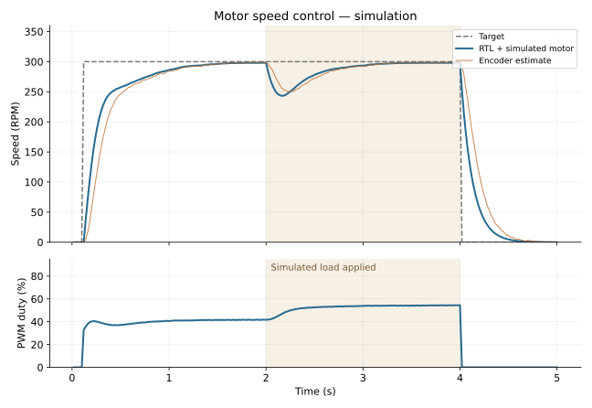
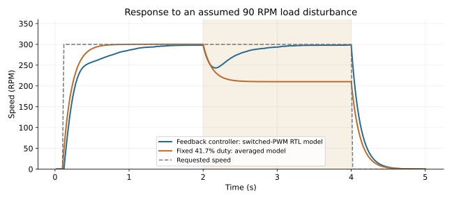

# Motor controller results

These are simulations, not measurements of a motor or a Zybo board.

The closed-loop trace comes from the actual RTL with encoder pins driven by a behavioral mechanical model. The test uses a 200 kHz simulation clock and 1 kHz PWM; the production top selects a 125 MHz clock and 20 kHz PWM. Both use a 50 Hz PI update and the same encoder CPR and gains. PWM ripple, motor behavior, and timing on a physical board remain unverified.

## 300 RPM experiment

| Metric | Simulated result |
|---|---:|
| Mean speed before load, 1.5–2.0 s | 297.73 RPM |
| Mean speed after load, 3.5–4.0 s | 298.13 RPM |
| Mean absolute error after load | 1.87 RPM |
| Minimum speed during load response | 243.31 RPM |
| Startup overshoot | 0.00% |
| Startup settling to ±2% | 1.259995 s |
| Recovery to ±2% after load | 1.0399949999999998 s |
| Mean duty before / after load | 41.65% / 54.31% |
| Fixed 41.7% drive after load, averaged model | 210.24 RPM |

The assumed plant has 720 RPM no-load speed and a 0.12 s mechanical time constant. The load is represented as a 90 RPM reduction in equilibrium speed at 2 s. It is removed when the stop command is sent at 4 s. This is not an identified transfer function for the reference motor: winding inductance, friction, gearbox backlash, supply sag, electrical current, and heating are omitted.

## Sensitivity and limits

The averaged Python model sweeps 54 combinations of assumed motor gain (540/720/900 RPM), time constant (0.06/0.12/0.24 s), target (100/300/500 RPM), and load (0/90 RPM). 48 cases have enough modeled headroom below the 90% duty cap. Worst final one-second mean absolute error among those cases: 0.45 RPM. Unreachable targets retain error rather than exceeding the duty limit. See [sensitivity.csv](sensitivity.csv).

The gains were selected for this assumed model. Real hardware needs conservative tuning and independent speed measurements. The sensitivity sweep changes parameters inside one simplified model; it does not establish physical robustness.

## Verification

- 19 Python tests: independent CRC check vector, corruption rejection, fragmented frames, signed arithmetic, analytic plant response, tracking, and saturation.
- Seven RTL benches: PWM, quadrature decoder, PI, fault core, serial link, end-to-end top, and switched-PWM closed loop.
- All 1,001 permille duty requests tested with both 1,000-clock and production 6,250-clock PWM frames.
- 541 PI vectors checked against the integer Python reference.
- Fault tests cover arm/stop, watchdog, stall, driver fault, reverse/invalid encoder motion, fault clearing, and invalid target rejection.
- Undefined controller states cause a test failure.

Full commands and results: [verification.txt](verification.txt). Parameters, versions, and source-trace checksum: [metrics.json](metrics.json).

Vivado, a physical motor, electrical current sensing, and an oscilloscope were unavailable during development. The Tk panel's protocol/model paths are covered by tests; its desktop window and real serial connection need a local check.
